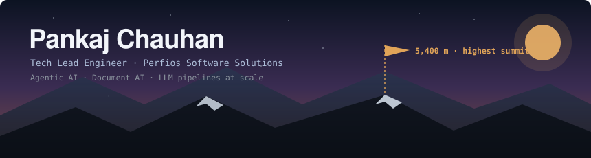
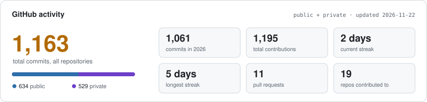
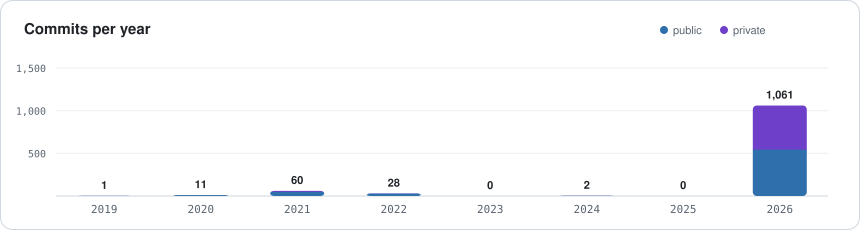
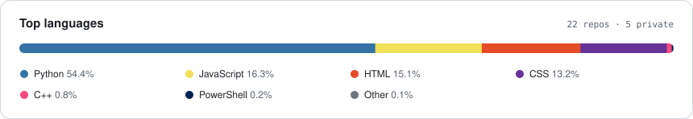
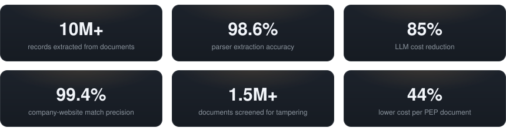

<div align="center">



<a href="https://pankaj-sde.pages.dev/"></a>
&nbsp;
<a href="https://www.linkedin.com/in/pankaj-chauhan-sde/"></a>
&nbsp;
<a href="mailto:pankajchauhan.nitsri@gmail.com"></a>
&nbsp;
<a href="https://pankaj-sde.pages.dev/resume.pdf"></a>

</div>

<div align="center">

[whoami](#whoami) &nbsp;·&nbsp; [Now](#now) &nbsp;·&nbsp; [Stats](#stats) &nbsp;·&nbsp; [Impact](#impact) &nbsp;·&nbsp; [Career](#career) &nbsp;·&nbsp; [Systems](#systems) &nbsp;·&nbsp; [Pinned](#pinned) &nbsp;·&nbsp; [Stack](#stack) &nbsp;·&nbsp; [More](#more) &nbsp;·&nbsp; [Contact](#trailhead)

</div>

---

<a id="whoami"></a>
### `~/whoami`

```json
{
  "name":     "Pankaj Chauhan",
  "role":     "Tech Lead Engineer",
  "company":  "Perfios Software Solutions",
  "location": "Dehradun, India · Perfios New Delhi (hybrid)",
  "focus":    ["Agentic AI", "LLM pipelines", "Document AI & OCR", "Web intelligence", "Python"],
  "now":      "Leading a team that builds AI-driven data intelligence products",
  "off_duty": "Altitude trekking — highest point 4,600 m",
  "mantra":   "Planning an expedition is a lot like planning a release."
}
```

Software engineer with 5+ years in Python and agentic AI. I lead a team that builds AI-driven data intelligence products — precision-first pipelines that turn messy documents and the open web into structured, decision-ready data. My work sits where classic data mining meets modern LLMs: OCR, table reconstruction and parser frameworks on one side; RAG, embeddings and LLM orchestration on the other, tuned for **97%+ accuracy at a fraction of the usual cost**.

---

<a id="now"></a>
### 🧭 What I'm working on

- **Business Classification Engine** — profiling Indian companies from their own websites to reveal what they *actually* do, beyond registered NIC codes. Powers lead generation, peer comparison and AML/KYC due diligence. Identity-verified website discovery runs in production at **99.4% precision**.
- **LLM taxonomy engine** — maps business activities to NIC-2008 codes on **self-hosted Qwen**: **98%+ accuracy, zero API cost**, and **97x faster** candidate retrieval through embedding caching.
- **Leading the team** — feasibility studies, cost analysis and pipeline design up front; **95%+ team utilization** and critical security vulnerabilities resolved across our services.

---

<a id="stats"></a>
### 📈 Activity & stats

<div align="center">

<picture>
  <source media="(prefers-color-scheme: dark)" srcset="https://raw.githubusercontent.com/PankajChauhanji/PankajChauhanji/output/stats-overview-dark.svg" />
  
</picture>

<picture>
  <source media="(prefers-color-scheme: dark)" srcset="https://raw.githubusercontent.com/PankajChauhanji/PankajChauhanji/output/stats-years-dark.svg" />
  
</picture>

<picture>
  <source media="(prefers-color-scheme: dark)" srcset="https://raw.githubusercontent.com/PankajChauhanji/PankajChauhanji/output/stats-languages-dark.svg" />
  
</picture>

<picture>
  <source media="(prefers-color-scheme: dark)" srcset="https://raw.githubusercontent.com/PankajChauhanji/PankajChauhanji/output/github-contribution-grid-snake-dark.svg" />
  
</picture>

<sub>Public + private repositories · refreshed every 6 hours by a workflow in this repo</sub>

</div>

---

<a id="impact"></a>
### 🏔️ Impact at a glance

<div align="center">



</div>

---

<a id="career"></a>
### The ascent — where I've shipped

#### Perfios Software Solutions &nbsp;·&nbsp; <sub>New Delhi</sub>

**Tech Lead Engineer** &nbsp;·&nbsp; <sub>Apr 2026 – present</sub>

- **Leading a team** delivering AI-driven data intelligence products — owning feasibility studies, cost analysis and pipeline design, with **95%+ team utilization** and critical security vulnerabilities resolved across services.
- **Architected a Business Classification Engine** that profiles Indian companies from their web footprint, unlocking **lead generation**, **peer comparison** and **AML/KYC due diligence** for KScan; identity-verified website discovery at **99.4% precision**.
- Developed an **LLM-driven taxonomy engine** on self-hosted Qwen that maps business activities from company websites to NIC-2008 codes — **98%+ accuracy**, **zero API cost**, **97x faster** candidate retrieval via embedding caching.
- **Engineered a DGFT trade-risk pipeline** that monitors export entities through daily court-judgment analysis, combining multi-stage OCR with prompt engineering to classify complex legal risk and extract compliance parameters.

**Senior Member of Technical Staff** &nbsp;·&nbsp; <sub>Apr 2024 – Mar 2026</sub>

- **Architected a Corporate Risk platform** monitoring Indian entities and management for adverse-media and governance risk — a 10K/day pipeline with custom ML noise-filters and a scalable API layer; prompt engineering cut LLM costs by **85%** while classifying fraud, litigation and misconduct.
- **Engineered a PEP screening pipeline** that extracts PAN from election affidavits in all Indian languages — robust to handwritten, rotated and degraded stamp-paper scans; dual-reader OCR + LLM consensus delivered **97% precision** at **44% lower cost**.
- **Built ocr_kit**, a unified multi-engine OCR framework (Google Vision, Tesseract, Azure) adopted across teams — smart page batching gave **3.3x faster** processing and **34% lower memory**.
- **Built an FIR intelligence pipeline** turning FIR PDFs from all Indian states and languages into structured data at million-record scale; custom table reconstruction and page-stitched OCR achieved **97.5% accuracy** at **85% lower OCR cost**.
- Led **table extraction** research for PDFs and images, delivering a solution that scaled to **10M+ records**.

**Software Engineer II** &nbsp;·&nbsp; <sub>Apr 2022 – Apr 2024</sub>

- Developed an industry-first **PDF tampering detection** solution for banking fraud — analysed 1.5M+ documents and built an automated scoring mechanism that slashed false positives.
- **Built Parser Utility**, a lightning-fast document-extraction framework unifying PDFs, images and multi-engine OCR under one API; declarative data mappers and complex table extraction turn new formats into configuration, while character-similarity OCR error correction, fuzzy search and smart ROI cropping cut development time by **80–85%** at **98.6% accuracy**.

#### Karza Technologies &nbsp;·&nbsp; <sub>Mumbai</sub>

**Software Engineer** &nbsp;·&nbsp; <sub>Jun 2021 – Apr 2022</sub>

- Built low-latency **KYC parser APIs** on Google and Azure OCR, cutting response time by **40%** through smart caching.
- Raised extraction accuracy by auto-correcting OCR errors and handling skewed or rotated PDFs and images.
- Replaced paid Adobe APIs with in-house parsers for complex tables, significantly cutting processing costs.
- Led RCA on production API discrepancies and migrated services to Python 3.11.

<details>
<summary><b>Earlier</b> — Software Development Intern · SmartServ · Jan 2021 – Jun 2021</summary>

<br>

SQL and MongoDB migration scripts, React and jQuery front-end features, and ownership from root-cause analysis to production release.

</details>

---

<a id="systems"></a>
### 🛠️ Systems I've built

#### Business Classification Engine

<div align="center">


</div>

Registry data (MCA, GST, NIC) says what a company is *registered* as — not what it does. This engine finds each company's official website, verifies it against identity evidence (CIN, GSTIN, PAN, address), crawls and cleans its business pages, and classifies the real activities into NIC-2008 codes with an embedding shortlist plus an LLM. Every stage is designed cheap-first: search, browser rendering and LLM calls are reserved for the cases that need them.

#### Corporate Entities Risk Platform

<div align="center">


</div>

Continuously crawls open-source news into MongoDB, cleans and de-noises the stream, then detects relevant businesses with NLP and an ensemble classifier. LLMs extract and filter the entities, profile each one for risk, and stitch the results back into a central entities database — turning a firehose of raw news into structured, queryable risk intelligence.

---

<a id="pinned"></a>
### 📌 Pinned

<!--START_SECTION:pinned-repos-->
| Repo | Description | Stack | ⭐ |
| :-- | :-- | :-- | --: |
| [**SuperCards**](https://github.com/PankajChauhanji/SuperCards) | Super seven cards game. | — | 5 |
| [**DrawHunt**](https://github.com/PankajChauhanji/DrawHunt) | Draw the word and guess game. | JavaScript | 4 |
| [**my_portfolio**](https://github.com/PankajChauhanji/my_portfolio) | My Portfolio | HTML | 3 |
| [**cric_ovo**](https://github.com/PankajChauhanji/cric_ovo) | Cricket tournaments management platform. | Python | 1 |
| [**cricket-analysis-prediction**](https://github.com/PankajChauhanji/cricket-analysis-prediction) | — | Jupyter Notebook | 4 |
| [**line_encoder**](https://github.com/PankajChauhanji/line_encoder) | Implementing the line encoding schemes | Python | 5 |
<!--END_SECTION:pinned-repos-->

---

<a id="stack"></a>
### The kit

**Languages**
&nbsp;


**Generative AI & LLMs**
&nbsp;


**Document AI & OCR**
&nbsp;


**Web & infra**
&nbsp;


---

<a id="education"></a>
### 🎓 Education

**National Institute of Technology, Srinagar** — *B.Tech, Information Technology* · 2017 – 2021

---

<a id="more"></a>
<details>
<summary><b>🏔️ Away from the keyboard</b></summary>

<br>

Long approaches and quiet summits in the Himalaya are how I reset — highest point reached so far is **4,600 m**. Planning an expedition turns out to be a lot like planning a release: load light, plan the route, respect the conditions, and keep moving.

</details>

<details>
<summary><b>📜 Certifications</b> — IBM / Coursera</summary>

<br>

- [RAG and Agentic AI](https://coursera.org/share/920288b8a01f570be6ecc0c0f108cb7f) — Specialization
- [Generative AI for Software Developers](https://coursera.org/share/e677124390f6b70b9dbe6f23f8863d3a) — Specialization
- [Advanced RAG with Vector Databases & Retrievers](https://coursera.org/share/847e231943eb0f614734b41fd800d220)
- [Agentic AI with LangGraph, CrewAI, AutoGen & BeeAI](https://coursera.org/share/a06e4ae58ee07e980be718acfb1511f7)
- [Build AI Agents using MCP](https://coursera.org/share/fc5f79e74ba8998e5e94e338fa0ab702)
- [Build Multimodal Generative AI Applications](https://coursera.org/share/b778bd48faea85c520e96ec494e67bac)

</details>

---

<a id="trailhead"></a>
### Trailhead

Open to interesting problems in **document AI**, **agentic AI** and **data-intelligence platforms**.

📍 Dehradun · Perfios New Delhi (hybrid) &nbsp;·&nbsp; 🔗 [Portfolio](https://pankaj-sde.pages.dev/) &nbsp;·&nbsp; 💼 [LinkedIn](https://www.linkedin.com/in/pankaj-chauhan-sde/) &nbsp;·&nbsp; ✉️ pankajchauhan.nitsri@gmail.com
